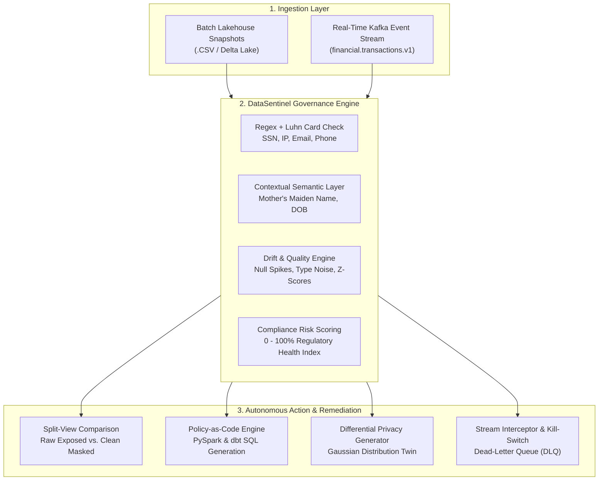

# 🛡️ DataSentinel AI
### Autonomous Data Governance, Schema Drift & Real-Time Quarantine Control Plane

[](https://fastapi.tiangolo.com)
[](https://www.python.org/)
[](https://spark.apache.org/)
[](https://www.getdbt.com/)
[](https://tailwindcss.com/)
[](#regulatory-compliance-mapping)

> **DataSentinel AI** is an autonomous, proactive governance control plane designed for modern enterprise lakehouses (Snowflake, Databricks, Delta Lake) and event streaming architectures (Apache Kafka, AWS Kinesis). It pairs deep batch audit capabilities with active streaming kill-switch interception, dynamic Policy-as-Code remediation (dbt & PySpark), and Differential Privacy synthetic data twin generation.

---

## 📑 Table of Contents
- [Executive Overview](#-executive-overview)
- [System Architecture](#-system-architecture)
- [Core Modules](#-core-modules)
  - [1. Batch Lakehouse Audit & Governance Engine](#1-batch-lakehouse-audit--governance-engine)
  - [2. Policy-as-Code Remediation Engine (dbt & PySpark)](#2-policy-as-code-remediation-engine-dbt--pyspark)
  - [3. Differential Privacy Synthetic Twin Generator](#3-differential-privacy-synthetic-twin-generator)
  - [4. Live Stream Quarantine Interceptor (Kafka DLQ)](#4-live-stream-quarantine-interceptor-kafka-dlq)
- [Repository Structure](#-repository-structure)
- [Quickstart & Installation](#-quickstart--installation)
- [API Reference](#-api-reference)
- [Regulatory Compliance Mapping](#-regulatory-compliance-mapping)
- [License](#-license)

---

## 🏛️ Executive Overview

Modern financial and enterprise data platforms face severe data leakage and pipeline corruption risks:
1. **Unmasked PII Leakage**: Raw cardholder numbers (PAN) and sensitive personal identifiers slip through bronze ingestion pipelines into analytics tiers.
2. **Silent Schema & Quality Drift**: Sudden null value spikes (>15%) and corrupt text noise inside numerical balance columns crash downstream machine learning models.
3. **Reactive Audit Delays**: Governance teams detect violations weeks after ingestion, requiring expensive incident responses and regulatory fines.

**DataSentinel AI** replaces reactive periodic audits with an **autonomous, proactive control plane**:
- **Active Quarantine Kill-Switch**: Intercepts streaming events in real time. If unencrypted plaintext cards or corrupt payloads are detected, they are quarantined to a Dead-Letter Queue (DLQ) in under 5 milliseconds.
- **Automated Remediation**: Auto-generates production-grade `dbt` and `PySpark` transformations so data engineers can fix pipeline vulnerabilities in seconds.
- **Zero-Trust Synthetic Data Twins**: Generates mathematical twin datasets preserving original Gaussian distributions and categorical weights for ML teams without exposing raw PII.

---

## 📐 System Architecture



---

## 🚀 Core Modules

### 1. Batch Lakehouse Audit & Governance Engine
- **Pattern Matchers & Luhn Check**: High-precision detection of Payment Card Numbers (with Luhn checksum validation), Social Security Numbers (SSN), Emails, IPv4 addresses, and US Phone numbers.
- **Sensitivity Hierarchy**: Categorizes findings into `CRITICAL` (PAN, SSN), `HIGH` (Email, Phone, Semantic Identifiers), and `MEDIUM` (IP Addresses).
- **Schema Drift & Anomaly Engine**:
  - Detects **Missing Value Spikes** (>15% null/empty strings flagged as Warning).
  - Detects **Type Mismatches** (e.g. string values like `"pending"` or `"N/A"` inside numeric transaction amount columns).
  - Flags **Distribution Outliers** via Z-score analysis ($|z| > 3.0$).
- **Dynamic Compliance Risk Score**: Computes an enterprise governance index from `0%` to `100%` with severity classifications (`Compliant`, `Moderate`, `Elevated Risk`, `Critical Risk`).

### 2. Policy-as-Code Remediation Engine (dbt & PySpark)
Instead of static reports, DataSentinel AI writes production-ready transformation artifacts:
- **Apache Spark / Databricks Delta Lake Pipeline**:
  - Dynamically builds `df_silver` dataframe transformations utilizing `F.regexp_replace` for cards/emails, `F.sha2(col, 256)` for SSNs, and `F.coalesce()` for null imputation.
  - Generates scripts to write directly into silver lakehouse tiers (`silver_lake.customer_transactions_governed`).
- **dbt SQL Transformation Model**:
  - Generates Snowflake / Databricks Unity Catalog compatible SQL models configured with `materialized='table'` and automated `CASE WHEN ... REGEXP_REPLACE` policies.
  - Built-in syntax viewer with one-click copy feedback.

### 3. Differential Privacy Synthetic Twin Generator
- **Statistical Fidelity**:
  - Computes empirical mean ($\mu$) and standard deviation ($\sigma$) of numerical features and samples using Gaussian distribution $\mathcal{N}(\mu, \sigma)$ with realistic bounding limits.
  - Preserves categorical feature probabilities using empirical distribution sampling.
- **100% Privacy Preservation**:
  - Replaces all identity fields with realistic synthetic values (synthetic names, valid Luhn-compliant test cards, internal domain emails).
- **Downloadable Artifact**: Dedicated endpoint to export clean synthetic CSV datasets for machine learning training without raw PII exposure.

### 4. Live Stream Quarantine Interceptor (Kafka DLQ)
- **Real-Time Stream Simulation**: Simulated consumer subscribing to Kafka topic `financial.transactions.v1` pushing transactions at 1.5s intervals via Server-Sent Events (SSE).
- **Active Kill-Switch**:
  - When clean records arrive, status displays `PASS` (latencies ~10–15ms).
  - When an unencrypted PAN or corrupt payload is detected, the runtime guardian triggers an immediate **KILL-SWITCH ACTIVATION**.
  - The live UI flashes a crimson alarm, isolates the violating payload, and routes the message to `financial.transactions.dlq`.
- **Interactive Rogue Injection**: Includes an on-demand **"⚡ Inject Rogue Plaintext PAN Payload"** button for live interactive demonstrations.

---

## 📂 Repository Structure

```text
DataSentinel AI/
├── main.py                         # Production FastAPI server & governance control plane
├── generate_mock_data.py           # Realistic 100-row dirty banking dataset generator
├── customer_transactions_dirty.csv # Sample banking snapshot with embedded PII and drift
├── requirements.txt                # Pinned production dependencies
├── .gitignore                      # Security exclusions (venv, .env, credentials, caches)
├── test_client.py                  # In-process FastAPI TestClient verification suite
├── test_e2e.py                     # HTTP end-to-end integration test
├── test_unit.py                    # Algorithmic unit tests (Luhn, Z-score, Masking)
└── static/
    └── index.html                  # Enterprise Dark Mode Single-Page Dashboard
```

---

## ⚡ Quickstart & Installation

### 1. Prerequisites
- **Python 3.10+**
- Git

### 2. Clone and Setup Environment
```bash
# Clone the repository
git clone https://github.com/Aryan-kashyap25/SentryLake.git
cd SentryLake

# Create a clean virtual environment
python -m venv venv

# Activate the virtual environment
# Windows (PowerShell):
.\venv\Scripts\Activate.ps1
# macOS / Linux:
source venv/bin/activate

# Install required dependencies
pip install -r requirements.txt
```

### 3. Generate the Dirty Banking Dataset
```bash
python generate_mock_data.py
```
*Creates `customer_transactions_dirty.csv` with 100 rows containing embedded credit cards, SSNs, null spikes (18% null emails), type noise, and transaction amount outliers.*

### 4. Launch the Enterprise Control Plane
```bash
uvicorn main:app --host 127.0.0.1 --port 8000 --reload
```

### 5. Access the Platform
- **Interactive Governance Dashboard**: [http://127.0.0.1:8000](http://127.0.0.1:8000)
- **Interactive Swagger API Docs**: [http://127.0.0.1:8000/docs](http://127.0.0.1:8000/docs)
- **OpenAPI Schema Specification**: [http://127.0.0.1:8000/openapi.json](http://127.0.0.1:8000/openapi.json)

---

## 🔌 API Reference

| Method | Endpoint | Description |
| :--- | :--- | :--- |
| `GET` | `/` | Serves the enterprise governance SPA dashboard |
| `POST` | `/api/audit-batch` | Ingests CSV snapshot; returns PII findings, drift metrics, and compliance score |
| `POST` | `/api/scan-sample` | 1-click audit trigger using the bundled 100-row dirty banking dataset |
| `POST` | `/api/generate-remediation` | Dynamically generates PySpark and dbt SQL transformation models |
| `POST` | `/api/generate-synthetic-twin` | Synthesizes a differential privacy twin preserving Gaussian statistics |
| `GET` | `/api/download-clean` | Streams sanitized, masked CSV dataset (`text/csv`) |
| `GET` | `/api/download-synthetic` | Streams synthetic twin dataset for analytics / ML modeling |
| `GET` | `/api/stream-simulator` | Server-Sent Events (SSE) stream simulating Kafka transaction stream |
| `GET` | `/api/stream-poll` | Polling alternative returning the latest real-time transaction event |
| `POST` | `/api/stream-inject-rogue` | Manually queues a rogue unencrypted PAN transaction to demo the kill-switch |

---

## 📜 Regulatory Compliance Mapping

| Regulatory Standard | Target Identifiers | Enforced Control Mechanism |
| :--- | :--- | :--- |
| **PCI-DSS 4.0** | Primary Account Numbers (PAN), Credit Cards | Regex + Luhn check; masked to `****-****-****-1234` or routed to DLQ |
| **GDPR (Art. 32 / 83)** | Emails, IPv4 addresses, Phone numbers | Tokenized username prefixes (`j***@corp.com`) and subnet redaction |
| **HIPAA Security Rule** | Social Security Numbers (SSN), Medical/Semantic Identifiers | SHA-256 cryptographic hashing (`ANON_<hash>`) and column-level encryption |

---

## 🧪 Testing & Verification

Run the comprehensive test suite locally to verify all engines:
```bash
# 1. Algorithmic unit checks (Luhn, Z-scores, masking functions)
python test_unit.py

# 2. In-process FastAPI endpoint testing
python test_client.py

# 3. Live HTTP end-to-end integration test
python test_e2e.py
```

---

## 📄 License
Distributed under the **MIT License**. Copyright (c) 2026 Aryan-kashyap25. See [LICENSE](LICENSE) for details.
